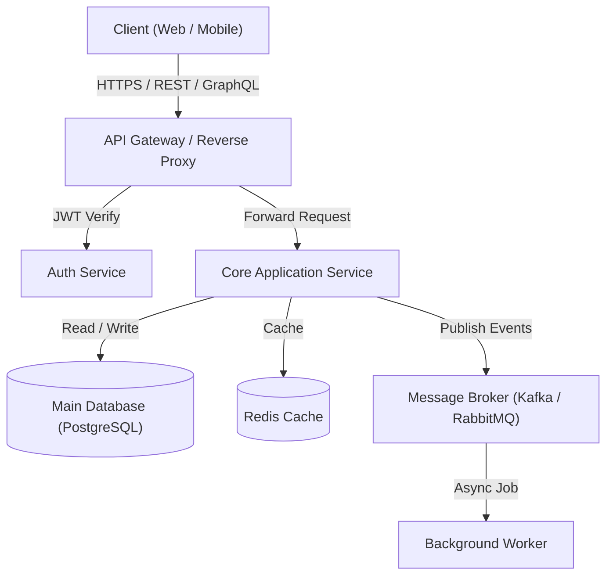
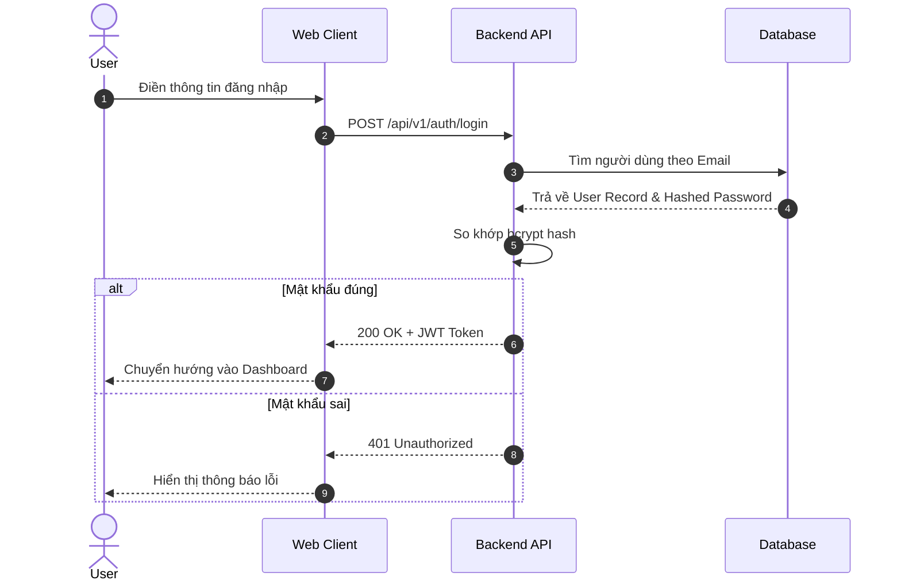

# Architecture & System Diagrams Standards

Sử dụng quy chuẩn này khi được yêu cầu giải thích kiến trúc hoặc mô tả luồng hoạt động của hệ thống.

---

## 1. Cú pháp Mermaid phổ biến

### Sơ đồ kiến trúc / Luồng dữ liệu (Flowchart)

### Sơ đồ tuần tự (Sequence Diagram)

---

## 2. Nguyên tắc vẽ sơ đồ
1. **Rõ ràng, không quá tải:** Một sơ đồ chỉ nên tập trung vào 1 phạm vi logic (không nhồi nhét toàn bộ hệ thống vào 1 hình duy nhất).
2. **Quy ước hình khối:**
   - Hình chữ nhật: Service / Component.
   - Hình trụ (`[(...)]`): Database / Storage.
   - Hình bình hành / Icon: External Third-party Service.
3. **Mô tả hành động trên mũi tên:** Luôn ghi rõ phương thức (HTTP method, message event) và dữ liệu truyền tải trên từng đường kết nối.
